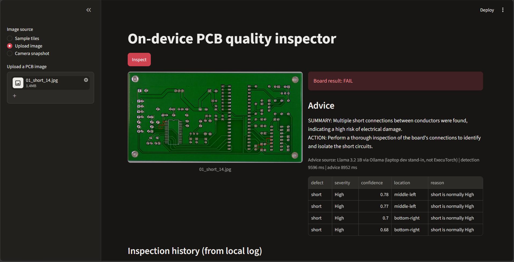
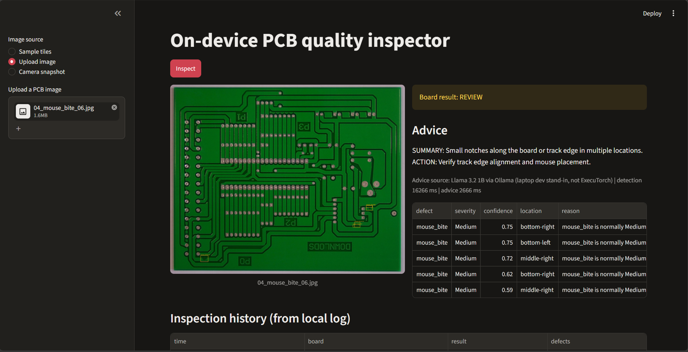
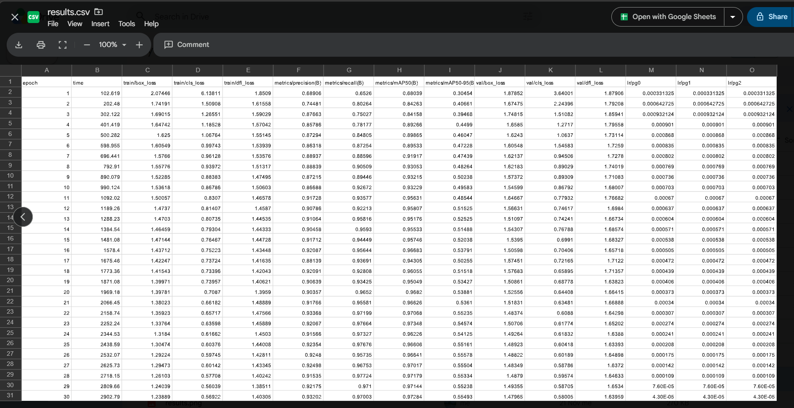
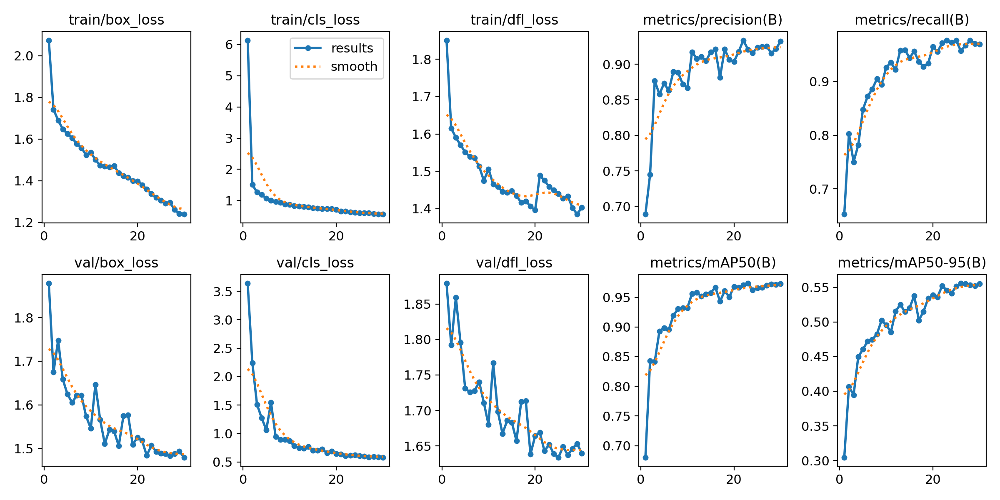

# PCB Edge Inspector

I built this for an Arm edge AI challenge. It looks at a photo of a circuit board, finds defects like open circuits and shorts, rates how serious they are, and gives the operator a PASS, REVIEW or FAIL. A small Llama model then writes a short note on what to do, and every inspection is saved to a local log.

## Where it stands

I'll be upfront about this, because it matters. I couldn't get an Arm board in time, so **nothing here has been run on an Arm device yet.** Everything below was tested on my Windows laptop.

- The detector, severity rules, logging and the Streamlit app all work.
- The Llama advice you see in the app comes from Ollama on my laptop. That is a stand-in for development. It is not ExecuTorch.
- I did cross-compile the ExecuTorch runtime for a Raspberry Pi 5, and I downloaded the model and tokenizer for it, but I never got to run it. The advice source is shown under every result in the app, so it's never hidden.

## What it looks like

The operator screen on a full board with several shorts. This is the laptop version, so the advice comes from Ollama, not ExecuTorch.



A close-up tile with two mouse bites, rated Medium, so the result is REVIEW.



Confusion matrix on the 138 validation boards.



Training curves for the 30-epoch run. Losses fall on both training and validation data, and mAP50 levels off near 0.97.



## How it works

1. A big board photo is cut into overlapping 640x640 tiles. The defects are tiny (about 2% of the image width), and shrinking the whole photo to 640 pixels would turn them into specks.
2. A YOLO11n model, exported to ONNX and run with ONNX Runtime, finds the defects in each tile. The boxes are merged afterwards.
3. A few plain Python rules decide severity. I wrote these myself:
   - open_circuit and short start at High
   - missing_hole, mouse_bite and spurious_copper start at Medium
   - spur starts at Low
   - a box covering 2% or more of the image goes up one level
   - detections under 0.25 confidence are ignored
   - the board FAILS if anything is High, goes to REVIEW if anything is Medium, and otherwise passes
4. The findings (defect type, severity, confidence, location) go to Llama 3.2 1B as text. It never sees the image. It writes a SUMMARY line and an ACTION line.
5. The result is shown in the Streamlit app and appended to `logs/inspections.jsonl`.

I tried an edge rule (lower the severity near the board edge) and took it out. The tiles are crops, so the edge of a tile isn't the edge of the board.

## Results

I used the PKU-Market-PCB dataset: 693 images, 6 defect types. I split it by whole board (555 for training, 138 for validation) so tiles from the same board never end up on both sides. After tiling that's 5,300 training tiles and 3,621 validation tiles. The model trained for 30 epochs on a Colab T4.

On the 138 boards it never saw:

- precision 0.925
- recall 0.957
- mAP50 0.967
- mAP50-95 0.557

Per class (AP50): missing_hole 0.986, open_circuit 0.981, mouse_bite 0.977, spurious_copper 0.967, spur 0.957, short 0.931. Short is the weakest, and it's one of the high-severity ones, so that's worth knowing.

Speed on my laptop CPU with ONNX Runtime: roughly 33 to 58 ms per tile, and about 1.2 seconds for a 3056x2464 board. Inside the Streamlit app the times were much higher (8 to 16 seconds on the first runs) and I haven't figured out why. These are laptop numbers, not Arm numbers.

## Things that aren't solved

- No measurements on an Arm device yet: FPS, latency, memory, tokens per second.
- The dataset is clean, close-up green boards. I haven't tested phone or camera photos, and I expect worse results on them.
- The sample boards I demo with come from the dataset. Only the validation numbers above say anything about accuracy.
- A 1B model can still give vague advice. The prompt keeps it grounded, but it isn't perfect.

## Running it

You need Python 3.12.

```bash
git clone https://github.com/sanskarg07/pcb-edge-inspector.git
cd pcb-edge-inspector
python -m venv .venv
source .venv/Scripts/activate      # Linux/macOS: source .venv/bin/activate
pip install -r requirements.txt
```

The dataset and trained model aren't in the repo because they're too big. To rebuild them:

1. Download PKU-Market-PCB from Kaggle into `data/raw/PKU-Market-PCB/`.
2. Run `python tile_dataset.py`. It creates `data/tiled/` and `data/pcb.yaml`.
3. Train. I used Colab:
   ```python
   from ultralytics import YOLO
   YOLO('yolo11n.pt').train(data='pcb.yaml', imgsz=640, epochs=30, batch=32, patience=10)
   ```
4. Export the result and save it as `models/best.onnx`:
   ```python
   YOLO('path/to/best.pt').export(format='onnx', imgsz=640, simplify=True)
   ```

For the Llama advice on a laptop, install [Ollama](https://ollama.com) and run `ollama pull llama3.2:1b`. Without it, the app falls back to simple rule-based text. You can pick the backend yourself:

```bash
ADVISOR_BACKEND=ollama streamlit run app.py        # default
ADVISOR_BACKEND=placeholder streamlit run app.py   # rules only
```

Then start the app with `streamlit run app.py`, pick a sample tile, upload an image or take a camera snapshot, and press Inspect.

## The ExecuTorch part

I built the runtime from ExecuTorch v1.4.1 using `examples/raspberry_pi/setup.sh pi5 --skip-env-setup`. The model file is a prebuilt Llama 3.2 1B Instruct SpinQuant `.pte` from `software-mansion/Llama-3.2-ExecuTorch`. **I did not export it myself.** The tokenizer comes from `meta-llama/Llama-3.2-1B-Instruct`. The command I planned to run on the board, from the ExecuTorch tutorial, is:

```bash
./llama_main --model_path ./llama_3_2_1b_xnnpack_spinquant.pte --tokenizer_path ./tokenizer.model --seq_len 128 --prompt "..."
```

## What's in the repo

- `tile_dataset.py`: cuts the dataset into tiles and writes the training yaml
- `detector.py`: the ONNX Runtime detector, including tiled detection for big photos
- `inspector_core.py`: severity rules and the inspection record
- `advisor_prompt.py`: the prompt that keeps Llama grounded in the findings
- `advisor.py`: gets the advice (Ollama backend, with a rule-based fallback)
- `logger.py`: the local inspection log
- `app.py`: the Streamlit operator screen
- `test_pipeline.py` and `time_test.py`: quick tests for the pipeline and timing

## Credits

- Dataset: PKU-Market-PCB from the Peking University Open Lab on Human Robot Interaction. I used a Kaggle copy that its uploader labelled Apache 2.0. Check the original source for the real terms.
- Detector: Ultralytics YOLO11, which is AGPL-3.0.
- Language model: Meta Llama 3.2, under the Llama 3.2 Community License. Built with Llama.
- Runtime: ExecuTorch from PyTorch, and the prebuilt model file from Software Mansion.

I used an AI assistant (Claude) for guidance, coding help and debugging. I ran, tested and evaluated everything myself.
